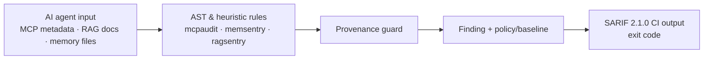

# aisec-suite

[](https://github.com/Pyhroff/aisec-suite/actions/workflows/tests.yml)
[](https://github.com/Pyhroff/aisec-suite/actions/workflows/benchmarks.yml)
[](https://pypi.org/project/aisec-suite/)
[](https://www.python.org/)
[](LICENSE)

**A CI security gate for the inputs an AI agent trusts but code scanners ignore: MCP tool metadata, agent memory files and RAG documents.**


## Headline result

I scanned **135 public MCP server repositories** (pinned commits, findings hand-labelled) and built a tool-poisoning detector that I evaluated on attacks it was not developed against:

| detector | recall, seen attacks | recall, held-out attacks | false-positive rate (3,974 real tool descriptions) |
|---|---|---|---|
| naive regex | 42.6% | **0.0%** | 0.0% |
| **aisec structural detector** | 74.1% | **53.7%** | **0.05%** (2 / 3,974) |

On attacks written by other people it catches **14.0%** of MCPTox (485 poisoned tools; naive regex 6.8%; no false positives on the servers' 362 real tools) and **14.0%** of MCP-Poison-Bench (86 metadata payloads; naive regex 10.5%). It catches none of MCP-Poison-Bench's 74 held-out payloads, which are phrased as ordinary documentation, and neither does any baseline. Both evaluations were pre-registered and run once; see `docs/STUDY.md` section 3c. A learned text classifier trained to close that gap did not: 0.8% on MCPTox at a 2.9% false-positive rate (section 3d), so it is not shipped. The memory-file and RAG scanners do worse on external attacks (BIPIA, InjecAgent): they catch the stock override phrase that opens many published injections and 0-3% of attacks written without it, no better than a naive regex (section 3e). A provenance-based runtime guard (`aisec.runtime_guard`), which holds calls that send data to destinations the user never named, stops 88.7% of AgentDojo attacks that have ground-truth calls (56.9% of all pairs as pre-registered) and asks for confirmation on 22.7% of benign tasks (section 3f).

Pattern matching memorises its own examples and finds almost nothing new. Scoring decoded text structurally (hidden Unicode, look-alike letters, base64/base32/hex/escape decoding, co-occurrence of model-directed, data-flow and concealment cues) generalises much better, but it still misses almost half of unseen attacks, so it is a review aid, not a security boundary.

It also holds up against cheap obfuscation: of the seen attacks it catches, at least 87.5% are still caught after look-alike letters, hard-wrapping, letter-spacing, sentence fragmentation, splitting across fields or base32/escape encoding (the previous version kept 14.7% under look-alike letters). The same study raised mcpaudit's precision from 38.8% to 69.4% at 80.6% recall.

Reachability (`--reach`) now follows commands across IPC bridges into engine-side scripts: on labelled findings it never wrongly cleared a real finding, and removed 4 of 30 unseen false positives (single-language reach removed none).

Every number on this page is re-derived from public data weekly by the [benchmarks workflow](.github/workflows/benchmarks.yml), which fails if any of them moves.

Across 135 real MCP servers I found **no tool poisoning in the wild**. Unconstrained-scope findings were by-design capabilities, not vulnerabilities, which is why the gate is a review aid rather than a vulnerability scanner.

Full method, confidence intervals and the caveats (including that the held-out set has now been evaluated three times) are in [`docs/STUDY.md`](docs/STUDY.md).

## Try it in two minutes

```bash
pip install "aisec-suite[core]"
bash examples/demo-mcp-server/run_demo.sh
```

The demo scans a small MCP server whose `add` tool hides an instruction to read `~/.ssh/id_rsa` and leak it through a parameter. The gate fails on it, then passes on the fixed version. See [`examples/demo-mcp-server`](examples/demo-mcp-server).

## What it scans

| Surface | Scanner | Status |
|---|---|---|
| MCP tool descriptions, schemas, permission scope | `mcpaudit` + built-in structural detector and reachability (`--reach`) | **Published** (`pip install "aisec-suite[core]"`) |
| Agent memory / context files (`CLAUDE.md`, `.cursorrules`, ...) | `memsentry` | **Published** |
| RAG source documents | `ragsentry` | **Published** |
| Fine-tuning datasets, agent traces | [`trainsentry`](https://github.com/Pyhroff/trainsentry), [`loopcheck`](https://github.com/Pyhroff/loopcheck) | Public source, not on PyPI; adapters included |
| Package installs, package worms | `agent-install-guardrail`, `wormsentry` | Private, adapters included |
| Model weights, inference receipts, activation traces, streaming side channels, formal checks of tool state machines | `weightspecter`, `attestinfer`, `circuitshield`, `tokenspecter`, `specprove-sec` | Research preview, private, evaluated only on synthetic fixtures |

Only the **Published** rows are installable from PyPI today. Adapters for the other scanners activate when those packages are installed from source; otherwise the CLI reports them as unavailable instead of failing.

## Usage

```bash
aisec scan .                                    # MCP + memory
aisec scan . --rag ./docs                       # add RAG documents
aisec scan . --reach annotate                   # add handler reachability evidence
aisec scan . --sarif aisec.sarif --json findings.json --fail-on high
aisec modules                                   # list scanners and whether each is installed
```

Exit codes with `--fail-on`: `0` nothing at or above the threshold, `1` findings at or above it, `2` a scanner crashed (reported as a warning, never mistaken for a finding).

## Reusable GitHub Action

Use the bundled composite action to standardize the scanner in another workflow. The example pins the action itself to an immutable commit; update that SHA only when intentionally upgrading the action:

```yaml
permissions:
  contents: read
  security-events: write

steps:
  - uses: actions/checkout@3d3c42e5aac5ba805825da76410c181273ba90b1 # v7.0.1
    with:
      persist-credentials: false
  - uses: Pyhroff/aisec-suite/.github/actions/aisec-scan@7b355445867cde3724365c6e9a132e4875a78569 # pinned action revision
    with:
      fail-on: high
      sarif: aisec.sarif
      json: aisec.json
      policy-profile: balanced
  - uses: github/codeql-action/upload-sarif@87ef0dc97def48aa960fbf026a2563ee9dbdb470 # v3
    with:
      sarif_file: aisec.sarif
```

For maximum reproducibility in production, pin both the `aisec-suite` action reference and its GitHub Action dependencies to immutable commit SHAs. The bundled composite action validates its dependency-extra input before using it in a shell command.

## Research-preview demos

`python -m research_preview wargame | guard-proxy | dashboard | remediate` are **scripted walkthroughs** of the private research modules. They run on fixed, synthetic inputs and their outcomes are pre-determined. They do not intercept traffic and are not detection results. The code lives in `research_preview/`, which is not part of the published wheel, and needs the private packages plus numpy.

## Package and release status

Latest release: **0.6.0** (PyPI: 0.2.0, 0.3.0, 0.4.0, 0.5.0, 0.6.0; earlier 2.x labels in the repository history were never published). Pin versions in CI rather than tracking the default branch. Policy as code, baselines, finding lifecycle, reporting formats and the release pipeline are documented in [`docs/REFERENCE.md`](docs/REFERENCE.md).

## Architecture

```text
            files in a repository / PR
                        │
      ┌─────────────────┼─────────────────┐
      ▼                 ▼                 ▼
   mcpaudit         memsentry         ragsentry        (+ optional private adapters)
  + structural
    detector
  + reachability
      │                 │                 │
      └─────────────────┼─────────────────┘
                        ▼
          normalized Finding (fingerprint, severity, evidence)
                        │
        policy / baseline lifecycle (new · existing · resolved)
                        │
        terminal · JSON · SARIF 2.1.0 · Markdown job summary · exit code
```



Design principles: static-first, never execute the scanned code, never follow symlinks out of the repo, fail closed on scanner crashes, and state measured limits next to every number.

## Development

```bash
pip install -c constraints.txt -e ".[core,dev]"
ruff check . && mypy
pytest -q -rs --cov     # -rs lists tests skipped because private scanners are absent
```

CI runs the unit tests on Python 3.10-3.13 with in-memory fake scanners, plus an integration job that installs the published scanners (versions in `constraints.txt`). Detector quality is guarded by `tests/test_poison_quality.py`. See [`CONTRIBUTING.md`](CONTRIBUTING.md).

## Limitations

- Static analysis of metadata and source: runtime behaviour, rug-pulls after review and attacks outside the implemented feature families are out of scope.
- The poisoning detector misses almost half of held-out attacks; positives are synthetic and single-author (see `docs/STUDY.md` section 3).
- Reachability is conservative: most findings stay `unknown`, and bridge resolution covers GDScript (Godot) and C# (Unity editor plugins) dispatchers only. A Unity server whose C# plugin is not in the same repository stays `unknown`.
- A clean scan is not a security guarantee. Treat findings as review input, not verdicts.

## Upstream security work

- **BerriAI/litellm**:
  - [PR #47312](https://github.com/BerriAI/litellm/pull/47312) (open): scope /v1/mcp/access_groups to caller-accessible servers for non-admin callers
  - [PR #47105](https://github.com/BerriAI/litellm/pull/47105) (open): authorization check on proxy endpoints when model lists are empty
- **PrefectHQ/fastmcp**:
  - [PR #6063](https://github.com/PrefectHQ/fastmcp/pull/6063) (open): wall-clock timeout and external callback limit in MontySandboxProvider and CodeMode

## Related projects

`mcpaudit`, `memsentry`, `ragsentry` (published) · `adversagen` (attack-side research used to test the detectors) · `agent-security-ci` (CI wiring example). See [`docs/PORTFOLIO.md`](docs/PORTFOLIO.md).

## License

MIT
